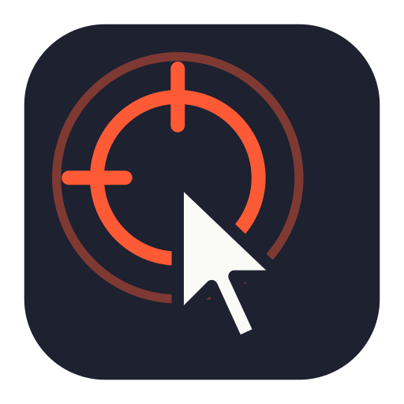
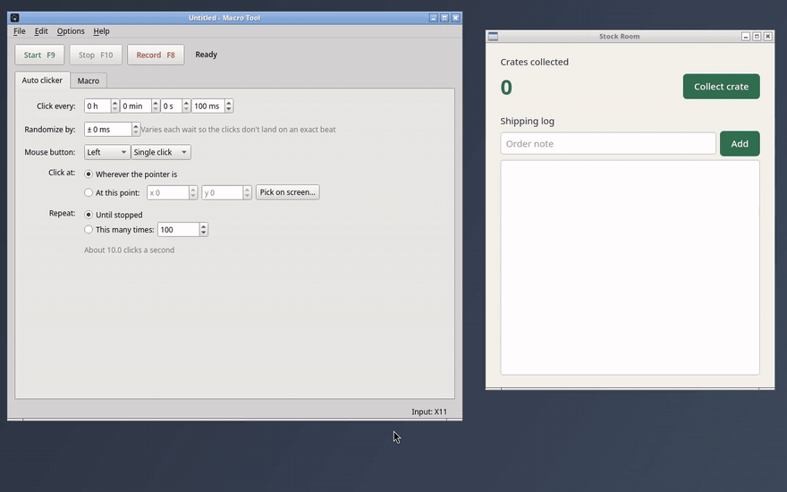
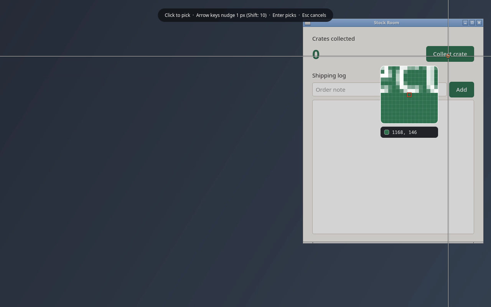
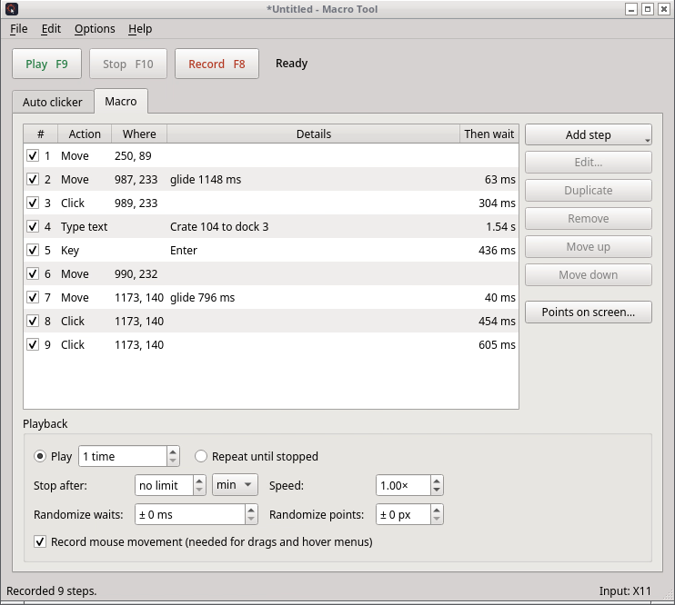

<div align="center">



# Macro Tool

An auto clicker and mouse and keyboard macro recorder.
Windows, macOS and Linux, on X11 and Wayland.

[Download](https://github.com/YatoVoid/Macro-Tool/releases/latest) ·
[Install](#install) ·
[How to use it](#how-to-use-it) ·
[Command line](#command-line)



[Watch the demo as video (MP4, 47 seconds)](docs/demo.mp4)

</div>

## What it does

- **Auto clicker.** Click every few milliseconds, seconds or hours, at a fixed point or wherever the pointer is, until you stop it or a set number of times.
- **Record a task once, replay it.** Clicks, typing, shortcuts, scrolling and pointer movement are recorded with their timing. Typing comes back as one "Type text" step and pointer paths as a few gliding moves, so a recording stays short enough to read and edit.
- **Pick points on the screen.** The screen freezes under a crosshair with a magnifier, so you can land on the exact pixel. Arrow keys nudge by one pixel.
- **Edit points visually.** "Points on screen" shows every click point of a macro, numbered and joined in order. Drag any of them to a new spot.
- **Global hotkeys.** F9 starts and stops, F10 stops, F8 records. They work while another app has focus, and you can change them.
- **Made to run for hours.** Timing is measured against the clock, so a 100 ms loop stays at 10 clicks a second all day instead of slowly drifting. Anything held down when playback stops is released. The screen is kept awake while a macro plays.
- **Undo for every edit,** step reordering by drag and drop, skipping steps without deleting them, and macros saved as plain JSON files.

<table>
<tr>
<td></td>
<td></td>
</tr>
</table>

## Install

| System | Download |
|---|---|
| Windows 10 and 11 | [`MacroTool-Setup.exe`](#windows) or the portable `MacroTool-portable.exe` |
| macOS 12 or newer, Apple Silicon | [`MacroTool-macos-arm64.dmg`](#macos) |
| macOS 12 or newer, Intel | [`MacroTool-macos-x86_64.dmg`](#macos) |
| Arch, Manjaro, EndeavourOS, CachyOS | [`yay -S macro-tool`](#arch-linux-and-derivatives) |
| Ubuntu 22.04+, Debian 12+, Mint, Pop!_OS, Zorin | [`.deb` package](#ubuntu-debian-and-derivatives) |
| Fedora, openSUSE, Nobara, RHEL-based | [`.rpm` package](#fedora-opensuse-and-other-rpm-systems) |
| Any other Linux | [AppImage or tarball](#any-other-linux) |
| Anywhere Python 3.10+ runs | [pipx](#from-source) |

Every download is on the [releases page](https://github.com/YatoVoid/Macro-Tool/releases/latest).

On Linux with Wayland, also do the one-time [Wayland setup](#wayland-setup).

### Windows

1. Download **`MacroTool-Setup.exe`** and run it. It installs for your user only, so it doesn't ask for an administrator password.
2. Windows may show **"Windows protected your PC"** because the app isn't signed. Click **More info**, then **Run anyway**.
3. Open **Macro Tool** from the Start menu.

No installer wanted? Download **`MacroTool-portable.exe`**, put it in any folder and run it. Settings are kept in your user profile either way.

To click inside a program that runs as administrator (Task Manager, some games and installers), Macro Tool has to run as administrator too: right-click it and choose **Run as administrator**.

**Uninstall:** Settings > Apps > Installed apps > Macro Tool > Uninstall. For the portable version, delete the file.

### macOS

1. Download the `.dmg` for your Mac: **arm64** for M1 and newer, **x86_64** for Intel. Not sure? Apple menu > About This Mac: "Chip: Apple" means arm64.
2. Open it and drag **Macro Tool** into **Applications**.
3. The app isn't notarized by Apple, so the first launch needs one extra step: right-click Macro Tool in Applications, choose **Open**, then **Open** again. If macOS says the app "is damaged", run this once in Terminal:
   ```
   xattr -dr com.apple.quarantine "/Applications/Macro Tool.app"
   ```
4. macOS asks for two permissions. Turn on Macro Tool in both, in System Settings > Privacy & Security:
   - **Accessibility**, to click and type
   - **Input Monitoring**, for hotkeys and recording
   - **Screen Recording** (optional), so the magnifier shows the real pixels when you pick a point

   Then quit Macro Tool and open it again.

**Uninstall:** drag Macro Tool from Applications to the Trash.

### Arch Linux and derivatives

Macro Tool is in the AUR as [`macro-tool`](https://aur.archlinux.org/packages/macro-tool):

```
yay -S macro-tool
```

or `paru -S macro-tool`. Without an AUR helper:

```
git clone https://aur.archlinux.org/macro-tool.git
cd macro-tool
makepkg -si
```

It pulls in `python-pynput` from the AUR as well. Then do the [Wayland setup](#wayland-setup) if you use Wayland.

**Update:** `yay -Syu`. **Uninstall:** `sudo pacman -R macro-tool`.

### Ubuntu, Debian and derivatives

1. Download **`macro-tool_<version>_amd64.deb`**.
2. Install it from a terminal in the download folder:
   ```
   sudo apt install ./macro-tool_*_amd64.deb
   ```
   Double-clicking the file to open it in the software center also works.
3. Open **Macro Tool** from the app menu.

Ubuntu uses Wayland by default, so do the [Wayland setup](#wayland-setup) next.

**Update:** install the newer `.deb` the same way. **Uninstall:** `sudo apt remove macro-tool`.

### Fedora, openSUSE and other RPM systems

1. Download **`macro-tool-<version>-1.x86_64.rpm`**.
2. Install it:
   ```
   sudo dnf install ./macro-tool-*.x86_64.rpm                 # Fedora, Nobara, RHEL-based
   sudo zypper install --allow-unsigned-rpm ./macro-tool-*.rpm  # openSUSE
   ```
3. Do the [Wayland setup](#wayland-setup). Fedora and openSUSE use Wayland by default.

**Uninstall:** `sudo dnf remove macro-tool` or `sudo zypper remove macro-tool`.

### Any other Linux

**AppImage:** download **`MacroTool-x86_64.AppImage`**, then:

```
chmod +x MacroTool-x86_64.AppImage
./MacroTool-x86_64.AppImage
```

If it says FUSE is missing, install it once: `sudo apt install libfuse2t64` on Ubuntu 24.04 and newer, `sudo apt install libfuse2` on older Ubuntu and Debian, `sudo dnf install fuse-libs` on Fedora, `sudo pacman -S fuse2` on Arch. Or run it without FUSE: `./MacroTool-x86_64.AppImage --appimage-extract-and-run`.

The AppImage can't install the udev rule, so do the [Wayland setup](#wayland-setup) by hand.

**Tarball:** download **`macro-tool-linux-x86_64.tar.gz`**, unpack it anywhere and run `macro-tool/macro-tool`.

### From source

Needs Python 3.10 or newer. [pipx](https://pipx.pypa.io) keeps it in its own environment:

```
pipx install git+https://github.com/YatoVoid/Macro-Tool
macro-tool
```

| System | Get pipx first |
|---|---|
| Windows | `py -m pip install --user pipx` then `py -m pipx ensurepath` |
| macOS | `brew install pipx` |
| Debian, Ubuntu | `sudo apt install pipx` |
| Fedora | `sudo dnf install pipx` |
| Arch | `sudo pacman -S python-pipx` |

### Wayland setup

Wayland doesn't let one app send input to another or read the keyboard globally. Macro Tool gets around that the same way Steam's controller support does: it creates a virtual keyboard and mouse through the kernel (`/dev/uinput`) and reads hotkeys straight from your input devices (`/dev/input`). Both need permission, given once:

```
sudo usermod -aG input $USER
```

Then log out and back in. Some systems also need the uinput module loaded at boot:

```
echo uinput | sudo tee /etc/modules-load.d/uinput.conf
sudo modprobe uinput
```

The `.deb`, `.rpm` and AUR packages load the module and install a udev rule for `/dev/uinput`, so on those only the `usermod` line is needed. X11, Windows and macOS need none of this.

Not sure which one you're on? The bottom right corner of the Macro Tool window shows the input method in use.

**What works on each Wayland desktop:**

| | Clicking, typing, hotkeys | Recorded clicks keep their position | Magnifier shows real pixels |
|---|---|---|---|
| KDE Plasma | yes | yes | yes |
| Hyprland | yes | yes | with `grim` installed |
| Sway and other wlroots | yes | no | with `grim` installed |
| GNOME | yes | no | no |

Where recorded clicks don't keep their position, they play back wherever the pointer is. Clicks added with **Pick on screen** always work, on every desktop. GNOME and Sway don't let apps see where the pointer is, and GNOME doesn't let them take screenshots, so the picker shows the live screen dimmed instead of a frozen copy.

## How to use it

### Auto clicker

1. Set **Click every** (hours, minutes, seconds, milliseconds).
2. Choose the mouse button and single, double or triple click.
3. Choose where: **Wherever the pointer is**, or **At this point** and press **Pick on screen…**.
4. Press **F9** to start and **F10** (or F9 again) to stop.

Starting with the Start button counts down 3 seconds first, so you can move to the right window. Turn that off in Options.

**Randomize by** varies each wait by up to that many milliseconds.

### Macros

Press **Record** (or F8) and do the task. Press **F8** again to stop. If the macro already has steps, you're asked whether to add the recording to the end or replace them.

Or build one by hand with **Add step**: clicks at picked points (one or several at a time), keys and shortcuts, text, waits, scrolling, pointer moves, and holding or releasing a key or mouse button.

Each step has a **Then wait** time. Double-click a step to edit it, drag steps to reorder them, and untick a step to skip it without deleting it. Ctrl+Z undoes any change.

**Playback options:** play a number of times or until stopped, stop after a time limit, play faster or slower, and randomize waits and click points slightly.

Untick **Record mouse movement** if you only care about where clicks land. Leave it on for dragging, drawing and menus that open on hover.

### Picking points

| Key | Action |
|---|---|
| Click | Pick the point |
| Arrow keys | Move the crosshair 1 pixel (with Shift: 10) |
| Enter | Pick the point under the crosshair |
| Mouse wheel | Zoom the magnifier |
| Esc | Cancel |

When adding several clicks at once, each click adds a point, Backspace removes the last one, and Enter or right-click finishes.

In **Points on screen…**, drag a point to move it, press Tab to select the next one, use the arrow keys to nudge the selected one, and press Enter to save.

### Hotkeys and options

**Options > Hotkeys** changes the global keys. A single letter or digit isn't allowed, since it would fire every time you type it.

Also under Options: the 3-second countdown, minimizing the window while playing, keeping the screen awake while playing (on by default), and keeping the window on top.

Your work is saved automatically and comes back the next time you open Macro Tool, even if it wasn't saved to a file.

## Command line

`macro-tool-cli` plays a saved macro without opening the window, for scripts, scheduled tasks or a remote session.

```
macro-tool-cli play farm.json
macro-tool-cli play farm.json --repeat 0 --stop-after 3600
macro-tool-cli check farm.json
```

| Option | What it does |
|---|---|
| `--repeat N` | Play N times; `0` repeats until stopped |
| `--stop-after SECONDS` | Stop after this long |
| `--speed X` | `2` plays twice as fast, `0.5` half as fast |
| `--delay SECONDS` | Wait before starting |
| `--stop-key KEY` | Global key that stops playback (default F10, `none` to turn it off) |
| `--screen WxH` | Wayland only, when run outside a desktop session |

On Windows it's `macro-tool-cli.exe`, in `%LOCALAPPDATA%\Programs\Macro Tool` after installing, or as a separate download on the releases page.

Ctrl+C stops it too. Exit codes: `0` finished or stopped, `1` playback error, `2` bad file or arguments, `3` input not available.

From the AppImage, run `./MacroTool-x86_64.AppImage cli play farm.json`. On macOS, run `"/Applications/Macro Tool.app/Contents/MacOS/Macro Tool" --cli play farm.json`.

## Limits

- **Games with anti-cheat** and some full-screen games ignore simulated input.
- **Typing on Wayland** uses the US keyboard layout. Letters, digits and common symbols work; accented letters and emoji don't, and on other layouts some symbols come out as the key in the same place. X11, Windows and macOS type any character.
- **Wayland** has been tried by hand on KDE Plasma with one monitor. GNOME, Sway, Hyprland and multi-monitor Wayland setups follow the same code paths but haven't been tried by hand yet.
- **Touchpad taps on Wayland** are recorded as clicks when tap-to-click is on in your desktop settings.
- **Windows:** can't click on the administrator prompt (UAC) or the lock screen. Windows blocks that for every app.
- **macOS:** the app isn't notarized. Builds are tested automatically on GitHub's Macs, but haven't been tried by hand on a real Mac yet; reports are welcome.
- Old configs from the earlier single-file version of Macro Tool open with **File > Open**.

## Development

```
git clone https://github.com/YatoVoid/Macro-Tool
cd Macro-Tool
python -m venv .venv
.venv/bin/pip install -e . pytest
.venv/bin/python -m pytest
```

The tests run on Windows, macOS and Linux in CI. `tests/test_x11.py` sends real clicks and keys to a test window on an X server; run it under Xvfb with `MACRO_TOOL_X11=1 xvfb-run pytest tests/test_x11.py`. Set `MACRO_TOOL_BACKEND=pynput` or `uinput` to force an input method.

Releases are built by GitHub Actions when a `v*` tag is pushed. See [CONTRIBUTING.md](CONTRIBUTING.md).

## License

[MIT](LICENSE)
